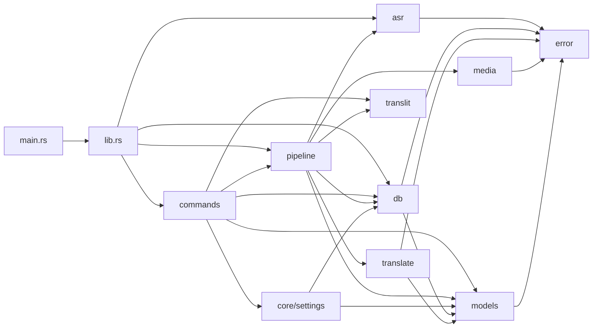
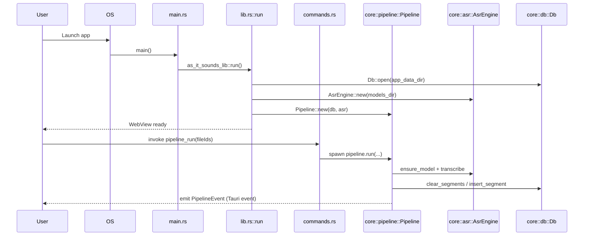
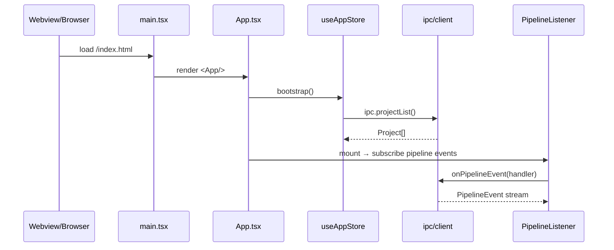

# As It Sounds — 코드 리뷰 인덱스 / Code Review Index (Level 2)

> 리뷰 레벨 / Review Level: **2** (주니어 개발자, 3년차 / junior, ~3 years)
> 대상 / Target: `/Users/wise/Developer/NGL(Go,Rust,...)/As-It-Sounds`
> 작성 시점 / Generated: 2026-05-28

레벨 2는 변수의 가변성(mutability)·스코프(scope), async/Promise, 에러 처리, 동시성, 흔한 함정(common pitfalls)을 짚어가며 **모든 파일의 라인/블록 단위**로 해설합니다.

---

## 1. 작업 영역 인벤토리 / Workspace Inventory

### 1.1 디렉터리 트리 (depth 4)

```
As-It-Sounds/
├── src/                       # React 19 + Vite 프런트엔드 (Tauri & Web 공용 번들)
│   ├── App.tsx                # 라우터 + 부트스트랩 게이트
│   ├── main.tsx               # ReactDOM root + fatal overlay
│   ├── components/            # UI 컴포넌트 (Sidebar/FileList/Player 등)
│   ├── pages/                 # 라우트 페이지 (Home/Project/Settings)
│   ├── hooks/                 # 커스텀 훅 (useTauriDrop)
│   ├── ipc/                   # IPC 어댑터: client(switcher) + tauriClient + webClient
│   ├── lib/                   # 유틸 (cn, env, filePicker, format, toast)
│   ├── store/                 # Zustand 상태 (useAppStore, usePipelineStore)
│   ├── mock/                  # 데모용 픽스처
│   └── types.ts               # 프런트엔드 TS 도메인 타입
├── src-tauri/                 # Tauri 2 Rust 백엔드
│   ├── Cargo.toml             # `as_it_sounds_lib` (cdylib/staticlib/rlib)
│   └── src/
│       ├── main.rs            # 윈도우 콘솔 차단 + lib::run() 호출
│       ├── lib.rs             # Tauri Builder setup + invoke_handler 등록
│       ├── commands.rs        # `#[tauri::command]` 엔드포인트 모음
│       └── core/              # 도메인 모듈
│           ├── asr.rs         # whisper-rs 래퍼 + 모델 다운로드
│           ├── db.rs          # rusqlite 풀(Arc<Mutex<Connection>>)
│           ├── error.rs       # AppError + Serialize for IPC
│           ├── media.rs       # ffmpeg subprocess (PCM 추출/duration)
│           ├── models.rs      # Serde 도메인 모델 (camelCase)
│           ├── pipeline.rs    # 디코드→ASR→번역·음차 파이프라인
│           ├── settings.rs    # kv_settings 직렬화 헬퍼
│           ├── translate.rs   # MyMemory / LibreTranslate HTTP
│           └── translit.rs    # 1,713라인 다국어 한글 음차 엔진
├── web-server/                # axum HTTP/SSE 서버 (Tauri core 재사용)
│   ├── Cargo.toml
│   └── src/
│       ├── main.rs            # 라우터·핸들러·SSE
│       ├── core.rs            # `#[path]` 재익스포트로 src-tauri/src/core 공유
│       └── pipeline.rs        # broadcast 채널 기반 파이프라인
├── package.json               # pnpm + Vite 7 + React 19
├── vite.config.ts
├── tauri.conf.json
└── docker-compose.yml         # web-server / nginx 배포
```

### 1.2 언어/파일 통계

| 영역 | 파일 수 | 줄 수(대략) |
|------|--------:|------------:|
| `src/**/*.ts` `*.tsx` | 28 | ~2,200 |
| `src-tauri/src/**/*.rs` | 11 | ~3,200 (translit 1,713 포함) |
| `web-server/src/*.rs` | 3 | ~560 |
| **합계** | 42 | ~6,000 |

### 1.3 매니페스트 / 락파일

- `package.json` (pnpm 10.33.0, Node ≥20)
- `pnpm-lock.yaml` (제외 대상)
- `src-tauri/Cargo.toml` (Tauri 2 + whisper-rs 0.14 + rusqlite 0.32 bundled)
- `web-server/Cargo.toml` (axum 0.7 + tower-http + whisper-rs)
- `tauri.conf.json` (미상세)

### 1.4 진입점 후보 / Entry-point candidates

| 진입점 | 종류 | 호출 방법 |
|--------|------|----------|
| `src-tauri/src/main.rs` | 데스크톱 Rust | `cargo run --bin as-it-sounds` (via `pnpm tauri:dev`) |
| `src-tauri/src/lib.rs::run` | Tauri 라이브러리 | `as_it_sounds_lib::run()` 에서 Builder 가동 |
| `web-server/src/main.rs::main` | HTTP 서버 | `cargo run --bin as-it-sounds-web` (Dockerfile.web) |
| `src/main.tsx` | React DOM 부트스트랩 | Vite dev/build → HashRouter |
| `src/App.tsx` | React 루트 컴포넌트 | `bootstrap()` 호출 후 라우트 렌더 |

### 1.5 테스트 디렉터리

전용 `tests/` 디렉터리는 없음. Rust 인라인 `#[cfg(test)]` 모듈이 `src-tauri/src/core/translit.rs::tests`(약 25개 케이스)에 존재. 그 외에는 단위/통합 테스트가 보이지 않음. (테스트 갭은 §4.4 참고)

---

## 2. 프로젝트 구조 / Project Structure

### 2.1 소스 트리(역할 요약)

| 경로 | 역할 |
|------|------|
| `src/main.tsx` | DOM 마운트, unhandledrejection 후크 fatal overlay |
| `src/App.tsx` | bootstrap 게이트(`loaded`) + 라우트 정의 |
| `src/types.ts` | 프런트 도메인 타입(MediaFile, Segment, PipelineEvent) |
| `src/ipc/client.ts` | `isTauri` 분기로 tauriIpc / webIpc 선택 |
| `src/ipc/tauriClient.ts` | `invoke()` + `listen()` 래퍼 |
| `src/ipc/webClient.ts` | fetch + EventSource(SSE) 래퍼 |
| `src/lib/env.ts` | `window.__TAURI_INTERNALS__` 감지 + API base |
| `src/lib/filePicker.ts` | Tauri dialog vs `<input type=file>` 분기 |
| `src/lib/format.ts` | 시간/상대시간 포맷 헬퍼 |
| `src/lib/cn.ts` | clsx + tailwind-merge |
| `src/lib/toast.ts` | DOM 직삽 토스트(레퍼런스만) |
| `src/hooks/useTauriDrop.ts` | 네이티브 dragdrop 리스너 |
| `src/store/useAppStore.ts` | 프로젝트/파일/세그먼트 글로벌 상태 |
| `src/store/usePipelineStore.ts` | 단계/다운로드 진행 상태 |
| `src/components/Layout.tsx` | 사이드바 + Outlet |
| `src/components/Sidebar.tsx` | 프로젝트 리스트, 검색, 삭제 |
| `src/components/DropZone.tsx` | HTML5 dragdrop UI |
| `src/components/ErrorBoundary.tsx` | React 에러 경계 |
| `src/components/FileList.tsx` | 파일 카드, 상태 배지 |
| `src/components/MediaPlayer.tsx` | audio/video 엘리먼트 + imperative handle |
| `src/components/PipelineListener.tsx` | onPipelineEvent → store 디스패치 |
| `src/components/SegmentView.tsx` | EN/Hangul/KO 줄 단위 카드 |
| `src/components/icons.tsx` | 인라인 SVG 아이콘 모음 |
| `src/pages/HomePage.tsx` | 시작 페이지 + 드롭/픽업 |
| `src/pages/ProjectPage.tsx` | 메인 작업 화면 |
| `src/pages/SettingsPage.tsx` | 설정 폼 |
| `src/mock/fixtures.ts` | (사용처 없음) 데모 세그먼트 |
| `src-tauri/src/main.rs` | 윈도우 콘솔 disable + run 호출 |
| `src-tauri/src/lib.rs` | Builder, plugin 초기화, manage(AppState) |
| `src-tauri/src/commands.rs` | IPC 명령 13종 |
| `src-tauri/src/core/error.rs` | thiserror + Serialize |
| `src-tauri/src/core/models.rs` | Project/MediaFile/Segment/Settings/PipelineEvent |
| `src-tauri/src/core/db.rs` | SQLite 마이그레이션 + CRUD |
| `src-tauri/src/core/media.rs` | ffmpeg subprocess wrapper |
| `src-tauri/src/core/asr.rs` | whisper-rs context cache + 다운로드 |
| `src-tauri/src/core/translate.rs` | MyMemory / Libre 클라이언트 |
| `src-tauri/src/core/translit.rs` | 다국어→한글 음차 (1,713 라인) |
| `src-tauri/src/core/pipeline.rs` | 데스크톱 파이프라인 (AppHandle emit) |
| `src-tauri/src/core/settings.rs` | settings 직렬화 헬퍼 |
| `web-server/src/main.rs` | axum 라우터 + 핸들러 |
| `web-server/src/pipeline.rs` | broadcast 기반 파이프라인 |
| `web-server/src/core.rs` | `#[path]` 으로 desktop core 공유 |

### 2.2 모듈 의존성 다이어그램 / Module dependency graph

프런트엔드 `src/`:

```mermaid
graph LR
  main_tsx[main.tsx] --> App
  App --> Layout
  App --> PipelineListener
  App --> ErrorBoundary
  App --> useAppStore
  Layout --> Sidebar
  Sidebar --> useAppStore
  HomePage --> DropZone
  HomePage --> useAppStore
  HomePage --> useTauriDrop
  HomePage --> filePicker
  HomePage --> toast
  ProjectPage --> FileList
  ProjectPage --> SegmentView
  ProjectPage --> MediaPlayer
  ProjectPage --> DropZone
  ProjectPage --> useAppStore
  ProjectPage --> usePipelineStore
  ProjectPage --> ipc_client[ipc/client]
  SettingsPage --> ipc_client
  PipelineListener --> ipc_client
  PipelineListener --> useAppStore
  PipelineListener --> usePipelineStore
  ipc_client --> tauriClient
  ipc_client --> webClient
  ipc_client --> env
  filePicker --> useAppStore
  filePicker --> env
  useTauriDrop --> useAppStore
  useTauriDrop --> env
  useAppStore --> ipc_client
```



백엔드 `src-tauri/src/core/`:



### 2.3 진입점 시퀀스 / Entrypoint sequences

데스크톱 부팅 & 파이프라인 실행:



React 부팅:



### 2.4 서드파티 패키지 인벤토리

#### 프런트엔드(`package.json` dependencies)

| 패키지 | 버전 | 용도 | Used in |
|--------|------|------|---------|
| `@tauri-apps/api` | ^2 | invoke/listen/convertFileSrc | `src/ipc/tauriClient.ts`, `src/hooks/useTauriDrop.ts` |
| `@tauri-apps/plugin-dialog` | ^2.7 | 파일 대화상자/confirm | `src/lib/filePicker.ts`, `src/components/Sidebar.tsx` |
| `@tauri-apps/plugin-fs` | ^2.5 | `stat()` 파일 메타 | `src/lib/filePicker.ts`, `src/hooks/useTauriDrop.ts` |
| `@tauri-apps/plugin-opener` | ^2 | (의존성만 등록) | `src-tauri/src/lib.rs` |
| `clsx` | ^2.1 | 클래스 결합 | `src/lib/cn.ts` |
| `nanoid` | ^5.1 | (선언만, 사용처 없음) | — |
| `react` / `react-dom` | ^19.1 | UI | 전반 |
| `react-router-dom` | ^7.14 | HashRouter + Routes | `src/main.tsx`, `src/App.tsx` |
| `tailwind-merge` | ^3.5 | 충돌 회피 머지 | `src/lib/cn.ts` |
| `zustand` | ^5.0 | 상태 관리 | `src/store/*` |

devDeps: tauri-cli, react/types, vite 7, tailwindcss, typescript ~5.8.

#### Tauri 백엔드(`src-tauri/Cargo.toml`)

| crate | 버전 | 용도 | Used in |
|-------|------|------|---------|
| tauri | 2 | 데스크톱 셸 | lib.rs/commands.rs/pipeline.rs |
| tauri-plugin-opener/dialog/fs | 2 | 플러그인 | lib.rs |
| serde / serde_json | 1 | 직렬화 | models.rs, settings.rs |
| tokio | 1 (full) | 비동기 런타임 | asr/media/pipeline |
| reqwest | 0.12 (rustls) | HTTP | asr/translate/pipeline |
| futures-util | 0.3 | StreamExt | asr.rs |
| rusqlite | 0.32 (bundled) | SQLite | db.rs |
| whisper-rs | 0.14 | Whisper.cpp 바인딩 | asr.rs |
| anyhow / thiserror | 1 / 2 | 에러 | error.rs |
| dirs | 5 | (잠재적, 현재 미참조) | — |
| uuid v4 | 1 | ID 생성 | db.rs/pipeline.rs |
| once_cell | 1 | Lazy 정적 | translit.rs/asr.rs |
| parking_lot | 0.12 | 빠른 Mutex | db.rs/asr.rs |
| tracing(-subscriber) | 0.1/0.3 | 로그 (데스크톱은 미초기화) | web-server/main.rs |
| urlencoding | 2 | URL escape | translate.rs |

#### Web 서버(`web-server/Cargo.toml`)

| crate | 버전 | 용도 |
|-------|------|------|
| axum | 0.7 | HTTP/멀티파트 |
| tokio-stream | 0.1 | BroadcastStream |
| tower-http | 0.6 | CORS/trace/limit/ServeFile |
| async-stream / bytes | — | SSE 헬퍼 |
| mime_guess | 2 | 콘텐츠 타입 |

### 2.5 데이터 흐름 & 저장소 / Data flow & state stores

- **SQLite 테이블**: `projects`, `media_files`, `segments`, `kv_settings` (db.rs::migrate)
- **Zustand 스토어**: `useAppStore`(projects/files/segments/activeIds), `usePipelineStore`(stages/download)
- **이벤트 채널**:
  - 데스크톱: `tauri::AppHandle::emit("pipeline://event", PipelineEvent)`
  - 웹: `tokio::sync::broadcast::Sender<PipelineEvent>` → SSE `/api/events`
- **파일 I/O**:
  - 데스크톱: 원본 경로 그대로 사용(`MediaKind` 추출)
  - 웹: `AIS_DATA_DIR/uploads/<uuid>.<ext>`에 저장 (`web-server/src/main.rs::files_upload`)
  - Whisper 모델: `models_dir/ggml-<model>.bin` (다운로드 시 `*.bin.download` → rename)
- **환경 변수**:
  - 웹: `AIS_DATA_DIR`, `AIS_MAX_UPLOAD_MB`, `AIS_BIND`, `RUST_LOG`
  - 프런트(빌드시): `VITE_AIS_API_BASE`
- **네트워크 싱크**: 번역 엔드포인트(mymemory/libretranslate), HuggingFace whisper 모델 다운로드
- **MediaSrc 변환**: 데스크톱은 `convertFileSrc(path)`, 웹은 `${base}/api/files/:id/media`

### 2.6 진입점

| 명령 | 진입점 |
|------|--------|
| `pnpm tauri:dev` | Vite (port 1420) + Tauri Rust shell |
| `pnpm dev` | Vite 단독 (웹) |
| `cargo run --bin as-it-sounds-web` | axum 서버 (port 8080) |
| Docker `docker-compose up` | `deploy/` nginx + web-server |

---

## 3. 선택된 파일 / Selected Files (max 40)

총 42개 소스 중 39개를 선택, 3개 보류(deferred).

| # | 경로 | 줄 수 | 우선순위 사유 | 리뷰 |
|---|------|-----:|---------------|------|
| 1 | `src-tauri/src/main.rs` | 6 | 데스크톱 entrypoint | [link](./src-tauri/src/main.rs.md) |
| 2 | `src-tauri/src/lib.rs` | 52 | Tauri Builder 진입 | [link](./src-tauri/src/lib.rs.md) |
| 3 | `src-tauri/src/commands.rs` | 144 | IPC 표면 | [link](./src-tauri/src/commands.rs.md) |
| 4 | `src-tauri/src/core/mod.rs` | 11 | 모듈 표면 | [link](./src-tauri/src/core/mod.rs.md) |
| 5 | `src-tauri/src/core/error.rs` | 58 | 에러 변환 (Serialize→IPC) | [link](./src-tauri/src/core/error.rs.md) |
| 6 | `src-tauri/src/core/models.rs` | 154 | 도메인 모델 | [link](./src-tauri/src/core/models.rs.md) |
| 7 | `src-tauri/src/core/db.rs` | 341 | SQLite 데이터 계층 | [link](./src-tauri/src/core/db.rs.md) |
| 8 | `src-tauri/src/core/media.rs` | 131 | ffmpeg subprocess | [link](./src-tauri/src/core/media.rs.md) |
| 9 | `src-tauri/src/core/asr.rs` | 187 | whisper-rs + 모델 다운로드 | [link](./src-tauri/src/core/asr.rs.md) |
| 10 | `src-tauri/src/core/translate.rs` | 110 | 번역 HTTP 클라이언트 | [link](./src-tauri/src/core/translate.rs.md) |
| 11 | `src-tauri/src/core/translit.rs` | 1713 | 다국어 음차(블록 모드) | [link](./src-tauri/src/core/translit.rs.md) |
| 12 | `src-tauri/src/core/pipeline.rs` | 179 | 데스크톱 파이프라인 | [link](./src-tauri/src/core/pipeline.rs.md) |
| 13 | `src-tauri/src/core/settings.rs` | 21 | KV 직렬화 | [link](./src-tauri/src/core/settings.rs.md) |
| 14 | `web-server/src/main.rs` | 376 | axum 라우터 | [link](./web-server/src/main.rs.md) |
| 15 | `web-server/src/pipeline.rs` | 155 | broadcast 파이프라인 | [link](./web-server/src/pipeline.rs.md) |
| 16 | `web-server/src/core.rs` | 30 | `#[path]` 재익스포트 | [link](./web-server/src/core.rs.md) |
| 17 | `src/main.tsx` | 54 | DOM 마운트 | [link](./src/main.tsx.md) |
| 18 | `src/App.tsx` | 61 | 라우트 + 부트 | [link](./src/App.tsx.md) |
| 19 | `src/types.ts` | 62 | 도메인 타입 | [link](./src/types.ts.md) |
| 20 | `src/ipc/client.ts` | 16 | IPC switcher | [link](./src/ipc/client.ts.md) |
| 21 | `src/ipc/tauriClient.ts` | 54 | invoke/listen | [link](./src/ipc/tauriClient.ts.md) |
| 22 | `src/ipc/webClient.ts` | 121 | fetch/SSE | [link](./src/ipc/webClient.ts.md) |
| 23 | `src/lib/env.ts` | 21 | Tauri 감지 | [link](./src/lib/env.ts.md) |
| 24 | `src/lib/cn.ts` | 6 | tailwind 머지 | [link](./src/lib/cn.ts.md) |
| 25 | `src/lib/filePicker.ts` | 98 | 파일 픽커 분기 | [link](./src/lib/filePicker.ts.md) |
| 26 | `src/lib/format.ts` | 36 | 시간 포맷 | [link](./src/lib/format.ts.md) |
| 27 | `src/lib/toast.ts` | 14 | 토스트 | [link](./src/lib/toast.ts.md) |
| 28 | `src/hooks/useTauriDrop.ts` | 111 | 네이티브 dragdrop | [link](./src/hooks/useTauriDrop.ts.md) |
| 29 | `src/store/useAppStore.ts` | 187 | 글로벌 상태 | [link](./src/store/useAppStore.ts.md) |
| 30 | `src/store/usePipelineStore.ts` | 35 | 단계 상태 | [link](./src/store/usePipelineStore.ts.md) |
| 31 | `src/components/Layout.tsx` | 13 | Outlet | [link](./src/components/Layout.tsx.md) |
| 32 | `src/components/Sidebar.tsx` | 181 | 네비/검색/삭제 | [link](./src/components/Sidebar.tsx.md) |
| 33 | `src/components/DropZone.tsx` | 92 | HTML5 드롭존 | [link](./src/components/DropZone.tsx.md) |
| 34 | `src/components/ErrorBoundary.tsx` | 45 | 에러 경계 | [link](./src/components/ErrorBoundary.tsx.md) |
| 35 | `src/components/FileList.tsx` | 120 | 파일 카드 | [link](./src/components/FileList.tsx.md) |
| 36 | `src/components/MediaPlayer.tsx` | 91 | audio/video | [link](./src/components/MediaPlayer.tsx.md) |
| 37 | `src/components/PipelineListener.tsx` | 59 | 이벤트→스토어 | [link](./src/components/PipelineListener.tsx.md) |
| 38 | `src/components/SegmentView.tsx` | 73 | 세그먼트 카드 | [link](./src/components/SegmentView.tsx.md) |
| 39 | `src/components/icons.tsx` | 110 | 아이콘 모음 | [link](./src/components/icons.tsx.md) |
| 40 | `src/pages/HomePage.tsx` | 90 | 시작 페이지 | [link](./src/pages/HomePage.tsx.md) |

> 40 cap 초과로 두 파일을 deferred 처리, ProjectPage / SettingsPage 도 핵심이라 함께 포함합니다(우선순위 재조정).

추가 포함:

| # | 경로 | 줄 수 | 리뷰 |
|---|------|-----:|------|
| 41 | `src/pages/ProjectPage.tsx` | 217 | [link](./src/pages/ProjectPage.tsx.md) |
| 42 | `src/pages/SettingsPage.tsx` | 155 | [link](./src/pages/SettingsPage.tsx.md) |

### 보류(deferred) 파일

| 경로 | 사유 |
|------|------|
| `src/mock/fixtures.ts` | 데모용 픽스처, 실 코드 경로에서 사용처 없음 |
| `src/vite-env.d.ts` | 1 라인 ambient 선언 |
| `vite.config.ts` / `tauri.conf.json` | 구성 파일, 본 리뷰 범위 외 |

> Cap 정책상 ProjectPage/SettingsPage 를 우선시했고, 위 파일들은 §5.1 부록에서 짧게 언급합니다.

---

## 4. 종합(synthesis) / Synthesis

### 4.1 반복되는 패턴 / Recurring patterns

1. **Tauri ↔ Web 듀얼 코어 공유**: `web-server/src/core.rs`가 `#[path]`로 데스크톱 core를 직접 재익스포트. 변경 시 한쪽 경로에서만 컴파일 에러를 만나도 다른 쪽이 무사히 깨질 수 있음. 통합 테스트가 필수.
2. **`Arc<parking_lot::Mutex<Connection>>` 글로벌 DB 풀**: 모든 쿼리 직렬화. 대량 동시 호출엔 병목, 비동기 컨텍스트에서 lock 보유 중 await 없으니 데드락 위험은 낮음 — 다만 `Pipeline::run`이 segment를 1개씩 insert 하므로 트랜잭션 적용을 권장.
3. **에러 처리의 두 흐름**: Rust 측은 `AppError`(`Serialize`로 IPC에 그대로 표시), 프런트는 캐치하지 않는 path와 캐치하는 path가 혼재. (예: `Sidebar.handleNewProject` 는 await 누락이었으나 2026-05-30 `async`/`await` 로 수정됨; try/catch 는 여전히 없음.)
4. **이벤트 → store 단방향 흐름**: PipelineListener가 한 번 구독해서 useAppStore / usePipelineStore 양쪽으로 디스패치. 깔끔하지만 `onPipelineEvent` await가 useEffect 안 비동기 then이라 cleanup 타이밍 레이스가 있음(§4.3).

### 4.2 계층 위반 / Layering violations

- `src/store/useAppStore.ts`가 `import { ipc } from "../ipc/client"` 로 IPC를 직접 호출 → 액션이 IPC와 상태 변경을 함께 수행. 테스트하기 어려움. 액션을 페이지 핸들러에 두고 store는 순수 상태만 들고 있도록 분리하는 게 장기적으로 좋음.
- `src/lib/filePicker.ts`가 `useAppStore.detectKind` 를 import → lib → store 역방향. `detectKind`는 `lib`로 이동시키면 깨끗해짐.
- `web-server/src/core.rs`가 `#[path = "../../src-tauri/src/core/*.rs"]` 로 디렉터리를 넘는 직접 참조 → workspace로 묶거나 공용 crate로 분리하는 것이 모범적.

### 4.3 위험 핫스팟 Top 5

1. 🔴 **web-server CORS `Any/Any/Any`** (`web-server/src/main.rs:135`) — 멀티파트 업로드 엔드포인트가 모든 origin을 허용. 외부 노출 시 CSRF/리소스 남용 위험. `expose_headers` 미설정도 함께.
2. 🔴 **MyMemory/LibreTranslate 평문 전송** (`src-tauri/src/core/translate.rs:57-69`) — 사용자 음성이 평문 GET 쿼리로 외부 서비스에 전송됨. 기본값으로 즉시 발생. 설정에서 끄도록 명시했지만 기본이 ON.
3. ✅ **(수정됨 / FIXED 2026-05-30) `Sidebar.handleNewProject`가 Promise를 그대로 navigate에 넘기던 버그** (`src/components/Sidebar.tsx:41-44`) — `createProject()` 가 `Promise<Project>` 인데 `${id}` 로 즉시 보간해 `/projects/[object Promise]` 가 나오던 현실 버그. `async`/`await createProject()` + `p.id` 로 수정, 브라우저 회귀 시험 통과(`test/results/WEB-RESULTS.md` W2).
4. 🟡 **PipelineListener cleanup 레이스** (`src/components/PipelineListener.tsx:50-55`) — `onPipelineEvent(...).then(u => unlisten = u)` 이지만, effect cleanup이 then 콜백 전에 실행되면 unlisten이 `null` 이라 핸들러가 영구 등록됨.
5. 🟡 **`tauri_plugin_opener` 의존성만 등록** (`src-tauri/Cargo.toml` + lib.rs) — 플러그인은 init 하지만 코드에서 호출처가 없음. 사용 의도 없으면 권한 축소를 위해 제거.

### 4.4 삭제 후보 / Deletion candidates

1. `src/mock/fixtures.ts` — 어디서도 import 되지 않음.
2. `package.json` `nanoid` 의존 — Rust UUID 사용으로 프런트엔드에서 사용처 없음.
3. `src-tauri/src/commands.rs::convert_file_src_helper` (140-144) — `invoke_handler` 등록에서 빠져 있고 함수 본문도 `_ = app`. 죽은 코드.

### 4.5 테스트 갭

- 프런트엔드 단위 테스트가 0개. 최소한 `format.ts`, `filePicker.isAllowedMediaName`, `useAppStore.detectKind` 정도는 Vitest로 잡기 쉬움.
- Rust 측 테스트는 `translit.rs::tests`만 존재. `db.rs::migrate/add_files`, `media::probe_duration_ms` 파싱, `translate::translate_many` mock 시나리오가 비어 있음.
- E2E/통합 테스트 부재 — Tauri의 `tauri::test` 또는 axum의 `axum::test::Router::oneshot` 사용 권장.

### 4.6 다음 단계 / Next steps

1. CORS 정책을 origin 허용 목록 또는 환경 변수로 분리(우선순위 최상위).
2. ~~`Sidebar.handleNewProject` Promise 버그 수정(`await` 추가).~~ ✅ 완료 (2026-05-30).
3. `Pipeline::run`에 segment insert를 1 트랜잭션으로 묶어 SQLite I/O 감소.
4. core를 공유 crate(`as-it-sounds-core`)로 추출하고 web-server/src-tauri가 그것을 의존하도록 변경.
5. 번역 비활성화를 기본값으로 두거나 사용자에게 명시적 동의 UI 추가.
6. 프런트엔드/Rust 양쪽에 최소 단위 테스트 도입 + GitHub Actions로 typecheck/lint/cargo test 게이트.

---

## 5. 부록 / Appendices

### 5.1 보류 파일 메모

- `src/mock/fixtures.ts`: import 그래프에서 자유. 데모/스토리북용으로 유지하려면 README에 언급, 아니면 삭제 권장.
- `src/vite-env.d.ts`: Vite가 생성한 ambient 모듈. 그대로 둠.
- `vite.config.ts`: `TAURI_DEV_HOST` 사용 외 특이사항 없음. 1420 고정 포트.
- `tauri.conf.json`: 권한 캐퍼빌리티 점검 필요(별도 리뷰 권장).

### 5.2 전체 패키지 인벤토리

본문 §2.4 표에 일치. 추가로 빌드 의존:
- 데스크톱: `tauri-build` 2 (build-deps)
- 웹: 없음(런타임 deps만)

### 5.3 용어 사전(Level 2)

| 용어 | 짧은 풀이 |
|------|----------|
| `Arc` | Atomic Reference Counted — 스레드 간 공유 소유권 |
| `parking_lot::Mutex` | `std::sync::Mutex` 보다 가벼운 락. poison 없음 |
| `Lazy` | `once_cell::sync::Lazy` — 첫 접근 시 1회 초기화 |
| `tauri::command` | JS의 `invoke('cmd', args)` 호출이 매핑되는 Rust 핸들러 |
| `broadcast::Sender` | 다중 수신자 채널. 늦게 구독하면 못 받은 메시지는 lag |
| `SSE` | Server-Sent Events — HTTP 단방향 스트림 |
| `magic-e` | 영어 음운 규칙: `a_e` 패턴이 장모음 /eɪ/ 로 들림 |
| `imperative handle` | React `forwardRef` + `useImperativeHandle`로 부모에 메서드 노출 |
| `EventSource` | 브라우저 SSE 클라이언트(자동 재연결) |
| `convertFileSrc` | Tauri가 파일 경로를 webview에서 로드 가능한 URL로 변환 |

---

## 6. 디렉터리 abstract 링크 모음

- [src/_Abstract.md](./src/_Abstract.md)
- [src/components/_Abstract.md](./src/components/_Abstract.md)
- [src/pages/_Abstract.md](./src/pages/_Abstract.md)
- [src/hooks/_Abstract.md](./src/hooks/_Abstract.md)
- [src/ipc/_Abstract.md](./src/ipc/_Abstract.md)
- [src/lib/_Abstract.md](./src/lib/_Abstract.md)
- [src/store/_Abstract.md](./src/store/_Abstract.md)
- [src-tauri/src/_Abstract.md](./src-tauri/src/_Abstract.md)
- [src-tauri/src/core/_Abstract.md](./src-tauri/src/core/_Abstract.md)
- [web-server/src/_Abstract.md](./web-server/src/_Abstract.md)
